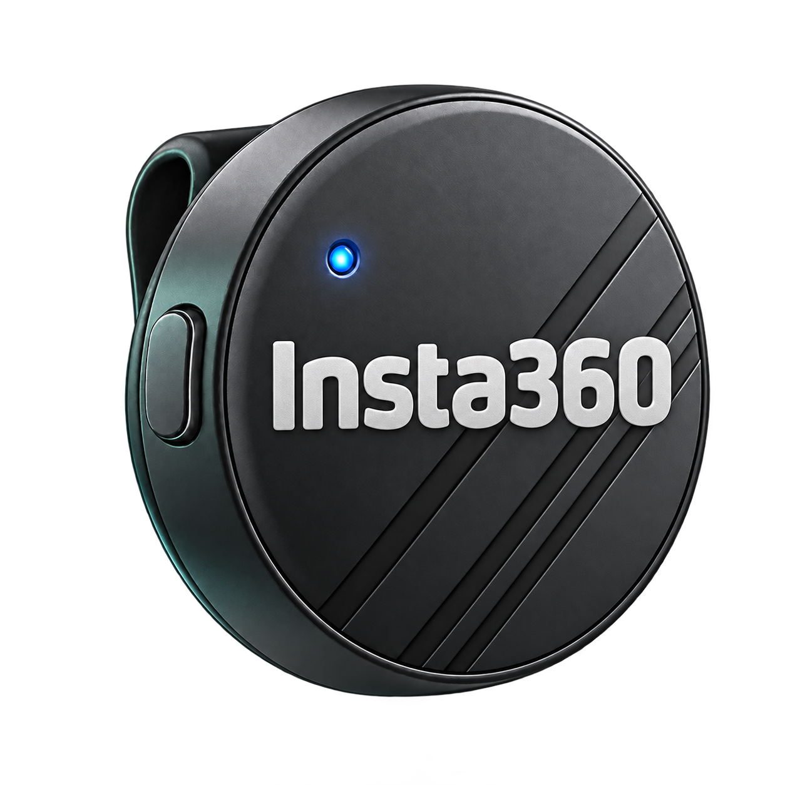

# AirKey

[中文](README.md) | **English**

Turn the **Volume Up signal from an Insta360 Mic Air receiver** into a voice-input shortcut for Doubao IME.

Current version: **v1.3.0**. For Intel / AMD **Windows x64**. The standalone EXE does not require a separate AutoHotkey installation for everyday use.

Original project code is MIT-licensed. The bundled Interception drivers and installer are subject to the upstream non-commercial-use conditions. Commercial use requires separate upstream authorization; see the [third-party notices](THIRD_PARTY_NOTICES.en.md).

[Download for Windows](https://github.com/yuhcaesar/mic-air-voice-button/releases/latest) · [User guide](assets/README.en.txt) · [Report an issue](https://github.com/yuhcaesar/mic-air-voice-button/issues)

<table>
  <tr>
    <td align="center"><br>Press the Mic Air side button</td>
    <td align="center">→</td>
    <td align="center"><br>Start Doubao IME voice input</td>
  </tr>
</table>

At runtime, AirKey prefers the icon from Doubao IME already installed on the user's computer. That brand icon is not included in this repository or the download. The microphone is a project illustration; the added “Insta360” text identifies the compatible device. It is not an official product photograph.

## Features

- Enable or pause with one button; a green status indicates that mapping is enabled.
- Sends **Right Alt + Space** by default. You can record another shortcut, distinguishing left and right Alt, Ctrl and Shift.
- A first-use wizard detects your button and lets you try it. Setup is saved and enabled only after you confirm that Doubao voice input started without changing volume.
- Tries another local connection when needed, without asking you to choose a device number.
- Saves a separate verified configuration on each computer. The previous enabled state is restored when that connection remains valid.
- Chinese by default, with an **English / 中文** button at the bottom right of the main window. The language choice is saved; switching keeps the voice button running.
- Minimizes to the system tray. Click the tray icon to restore the window, or right-click for the menu.
- Includes **Set Up Button Again** and **Uninstall & Restore**.

## First use

1. Download and open `AirKey.exe` from [Releases](https://github.com/yuhcaesar/mic-air-voice-button/releases), then connect the Mic Air receiver. In Doubao IME, set the hands-free voice-input shortcut (免按模式) to **Right Alt + Space**.
2. Click **Install & Enable** and approve the Windows administrator prompt.
3. After installation, save your work and **restart Windows manually**, then reopen the app. The button setup wizard opens automatically when the driver is ready.
4. Press your Mic Air button once so AirKey can detect it.
5. Click the wizard's input box, then press your Mic Air button again to try starting Doubao voice input.
6. Confirm that **Doubao starts, volume stays unchanged and no volume overlay appears**, then choose **Both work, finish setup**. Choose **Voice failed, try another** if voice input fails, or **Volume still changes** if volume changes; that result will not be saved.

AirKey saves and enables this computer's configuration only after receiving a real button event, running a trial and getting your confirmation that both voice and volume behave correctly. It does not automatically detect whether Doubao has started recording. AirKey does not save the contents of the trial input box. If the driver is already installed and loaded, skip reinstallation and complete button setup. After cancelling, click **Set Up Voice Button** to start again.

Minimizing hides the window in the system tray while the app keeps running. Click the tray icon to restore it; Windows may place it in the hidden-icons area. Opening the EXE again restores the existing window instead of starting a second instance.

Closing the window or choosing **Exit** in the tray menu stops mapping and exits. AirKey does not restart Windows automatically or configure startup at sign-in.

### Language and upgrades

AirKey starts in Chinese by default. Click **English** at the bottom right of the main window to switch to English; click **中文** in the same place to switch back. The choice is saved. You do not need to open Settings, restart the app or pause an enabled voice button.

The main window, button setup wizard, tray menu, shortcut recorder and app messages are available in both languages. The wizard keeps the language it had when opened; close it before switching. **User Guide** opens the guide for the selected language. Windows-provided dialogs, such as permission prompts, follow the system language.

The English window title is **AirKey — Insta360 Mic Air**; the Chinese title is **AirKey · 语音键 — Insta360 Mic Air**.

To upgrade, quit the old app and standalone volume probe, then replace its EXE with `AirKey.exe`. An installed, working driver does not need to be reinstalled. Upgrading to v1.3.0 requires confirming both voice activation and unchanged volume. Older voice-only verification is not accepted as volume verification. Your existing shortcut and language settings continue to use `%LOCALAPPDATA%\MicAirDoubao`; the folder name is retained for compatibility. The repository remains at `yuhcaesar/mic-air-voice-button`.

Each computer saves its own verified configuration. Complete the wizard again on a new computer, when the previous connection disappears, or when the saved connection can no longer be identified reliably. Copying the EXE or an old settings file does not replace verification on the new computer.

### Change the shortcut

Open **Settings → Edit → Start Recording**, press the shortcut configured in Doubao IME, then save. After changing the shortcut, complete button setup again to confirm that the new combination starts Doubao voice input.

**AirKey and Doubao IME must use the same shortcut.** This changes the keys sent by AirKey; it does not change Doubao IME's own settings.

### Set up the button again

If the button stops responding or you need to set it up again, open **Settings → Set Up Button Again**. The wizard detects the Mic Air button again and lets you try the available connections. It saves the new result only after you click **Both work, finish setup**. Your chosen shortcut stays the same, and AirKey does not automatically decide whether Doubao started.

### Diagnose an unresponsive older version

The standalone [AirKey Button Diagnostics tool](diagnostics/README.en.md) checks raw signals, legacy input handling, system hotkeys, keyboard hooks, and shortcut output. It creates a report without personal identifiers and does not install drivers or change AirKey settings. [Download the diagnostic tool](https://github.com/yuhcaesar/mic-air-voice-button/releases/tag/diagnostics-v0.1.0).

### Restore Volume Up / uninstall

- Temporarily stop voice activation: click **Pause Voice Button**. This also removes the volume guard.
- Remove the driver: click **Uninstall & Restore**, restart Windows manually after completion, then delete the EXE.
- Settings, logs and extracted components are stored in `%LOCALAPPDATA%\MicAirDoubao`. After uninstalling the driver and quitting the app, you may delete this app-specific folder.

Do not manually delete driver files from the Windows system directory. Uninstalling Interception also affects other applications using that driver.

## Limitations

- Setup checks registered hotkeys, keyboard hooks and raw device input. It prefers registered hotkeys only after an actual event, without asking you to choose a mode. Keyboard-key methods also handle other received Volume Up keys, which may start voice input.
- Raw device input starts the built-in volume guard. It consumes all volume-up commands reaching that channel, not just Mic Air. Use the system slider to adjust volume. Pause, exit or input failure removes the guard; no standalone probe is needed.
- Some applications handle media keys themselves or use another input path and may bypass the guard. Verify your everyday apps; pause and repeat setup if volume still changes. AirKey does not restore volume after a change. Initial button detection may change volume once; the guard is active for the later trial.
- Triggers are spaced at least approximately 1.5 seconds apart to avoid repeated activation from one press.
- AirKey only sends a shortcut. It does not record audio, upload data, log ordinary typing or detect whether Doubao is currently recording.
- Driver installation and removal need administrator permission and a subsequent restart.
- The underlying trigger has worked with a Mic Air receiver on one Windows 11 x64 computer; compatibility with every computer is not guaranteed. Setup counts as successful only after a button event is received and you confirm that Doubao voice input started without changing volume on that computer. Long sleep cycles and repeated hot-plugging have not been comprehensively tested.
- Interception v1.0.1 is old. [Kanata's Windows known issues](https://github.com/jtroo/kanata/blob/main/docs/platform-known-issues.adoc) document sleep and device hot-plugging problems with the driver on some systems.
- Windows on ARM is not supported. The EXE is not code-signed. The setup wizard cannot automatically resolve a driver blocked by Windows. If Windows blocks the driver, stop installation or uninstall it and keep system security protections enabled.

## Why a driver is needed

In this project's test environment, Mic Air reported Volume Up through its receiver, but ordinary software-generated shortcuts did not start Doubao voice input. AirKey receives the button through registered hotkeys, keyboard hooks or Windows Raw Input, then uses Interception to send scan codes. Raw device input also starts the project WH_SHELL volume-command guard, which needs no new driver.

The default Right Alt + Space uses the sequence that worked in testing. The app does not use Interception to intercept raw keyboard input and does not modify the Doubao application.

## Build from source

Install [AutoHotkey v2 x64](https://www.autohotkey.com/) and [Ahk2Exe](https://github.com/AutoHotkey/Ahk2Exe), then run this in the repository folder:

```powershell
.\build.ps1
```

The output is `dist\AirKey.exe`. Use `-Runtime` and `-Compiler` to specify tool paths, or set the `AHK_RUNTIME` / `AHK_COMPILER` environment variables. Building does not install a driver or run the resulting EXE.

This release uses AutoHotkey **2.0.30 x64** and Ahk2Exe **1.1.37.02a2**. See [THIRD_PARTY_NOTICES.en.md](THIRD_PARTY_NOTICES.en.md) for dependency versions, licenses and sources.

The repository includes `assets/volume-guard.dll`, built from the MIT-licensed `native/volume-guard.c`. To rebuild it, install Windows x64 [TinyCC 0.9.27](https://download.savannah.gnu.org/releases/tinycc/) and run:

```powershell
.\native\build-volume-guard.ps1 -NativeCompiler 'D:\Tools\tcc\tcc.exe'
.\native\tests\run-tests.ps1 -NativeCompiler 'D:\Tools\tcc\tcc.exe'
```

Update its SHA256 in `Main.ahk`, then run `build.ps1` again. The DLL only calls Windows system APIs and links no compiler runtime. Building and isolated tests do not activate the guard or send real key input.

### Third-party source and rebuilding

Each binary Release provides `ThirdParty-Sources.zip` on the same release page. It contains the matching AutoHotkey and Interception upstream source. Together with this repository's source, it supplies the source materials needed to rebuild; install each upstream toolchain according to its instructions.

To modify the Interception API DLL, first build an x64 DLL from the upstream source. Replace `assets/interception.dll`, update that DLL's SHA256 value in `Main.ahk` to match the new file, then run `build.ps1`. To modify AutoHotkey, build an x64 interpreter using the supplied upstream instructions and select it with `build.ps1 -Runtime <path>`. Source changes and rebuilding do not require additional permission from this project; third-party components remain subject to their own licenses.

The EXE extracts and verifies its embedded components, so directly replacing the DLL in its runtime folder will be overwritten. Use the rebuilding method above. This project does not prohibit lawful reverse engineering to debug user modifications.

### Tests

```powershell
.\tests\run.ps1
```

Tests cover syntax, shortcut parsing, send order, key release after failures, settings persistence and stopping behavior, plus localization and hidden wizard windows. Sends are replaced with in-memory mocks. Tests do not install a driver, send real shortcuts or alter everyday settings.

The physical Mic Air button, Doubao activation and driver installation/removal require manual verification. The user confirmed that the standalone volume probe preserved Doubao activation without changing volume on another computer. The integrated app still requires confirmation on the target computer; this does not establish compatibility with every computer or application.

## Project layout

| File | Purpose |
| --- | --- |
| `Main.ahk` | Main UI, configuration, Volume Up mapping and lifecycle |
| `SetupWizard.ahk` | First-use button setup wizard and trial input box |
| `MicSetupController.ahk` | Button detection, connection trials and user confirmation |
| `ButtonInput.ahk` | Registered hotkeys, keyboard hooks and device-specific Consumer HID input |
| `NativeVolumeGuard.ahk` / `native/` | Volume guard, native source and rebuild script |
| `MachineProfile.ahk` | Local verified configuration and connection matching |
| `Localization.ahk` | Bilingual text, notices and errors |
| `NativeOutput.ahk` | Interception output and connection selection |
| `DriverManager.ahk` | Driver status, official installer invocation and integrity checks |
| `ShortcutConfig.ahk` | Shortcut parsing, key sequence and release recovery |
| `ShortcutRecorder.ahk` | Shortcut recording window |
| `ModernControls.ahk` | Native button drawing |
| `AppArtwork.ahk` | Locally installed IME icon discovery and original artwork fallback |
| `TrayWindow.ahk` | Minimize to tray, click to restore and existing-instance activation |
| `assets/` | UI artwork, dependencies and their original licenses |
| `tests/` | Local checks without real key sends |

## License and attribution

Original project code is available under the [MIT License](LICENSE). Third-party components retain their own licenses. The project's MIT license grants no Insta360 or other third-party trademark rights. See [THIRD_PARTY_NOTICES.en.md](THIRD_PARTY_NOTICES.en.md).

The complete [Chinese notices](THIRD_PARTY_NOTICES.md) are also available; the supplied original upstream licenses are unchanged.

AirKey is an independent project with no official affiliation with or endorsement by Insta360 or Doubao.
